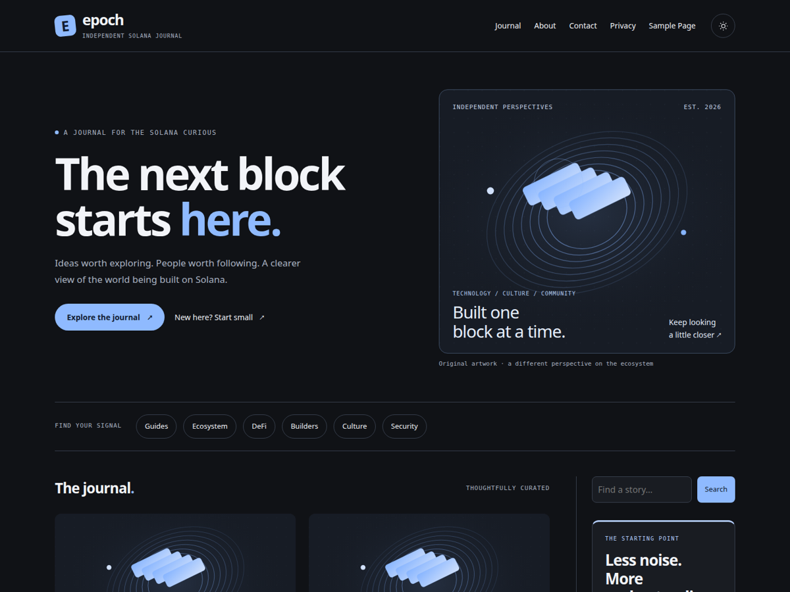
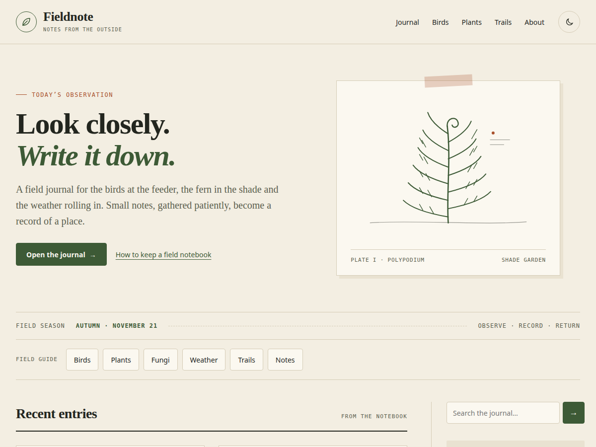

# Gonk Themes

Original, free Blogger and WordPress themes for crypto communities. Built one design at a time.

**[Browse themes and live previews](https://gonkfun.github.io/)** · **[Download releases](https://github.com/gonkfun/themes/releases)** · [gonk.fun](https://gonk.fun/)

## Available themes

| Theme | Audience | Platforms | Source | Download |
|---|---|---|---|---|
| **Epoch** | Solana editorial and community publishing | Blogger / WordPress | [Files and guides](themes/epoch) | [Epoch v1.0.0](https://github.com/gonkfun/themes/releases/tag/epoch-v1.0.0) |
| **Fieldnote** | Nature journals: naturalists, gardeners, birdwatchers, walkers | Blogger / WordPress | [Files and guides](themes/fieldnote) | [Fieldnote v1.0.0](https://github.com/gonkfun/themes/releases/tag/fieldnote-v1.0.0) |





## Install

- **Blogger:** download the Blogger ZIP, extract it and restore `epoch-blogger.xml` in Blogger → Theme. Upload the supplied favicon in Blogger → Settings → Favicon. Read the [Blogger guide](themes/epoch/docs/BLOGGER.md).
- **WordPress:** upload the WordPress ZIP directly through Appearance → Themes → Add Theme → Upload Theme. Do not unzip it. Read the [WordPress guide](themes/epoch/docs/WORDPRESS.md).

The themes are free. A WordPress.com free plan does not permit custom theme uploads; use compatible hosting or local WordPress for testing. GitHub Pages serves static design previews, not a PHP WordPress installation.

## Credits and ownership

Each theme includes a discreet **Powered by gonk.fun** footer link, qualified `nofollow`. You may edit or remove it. No encrypted credit, forced redirect, anti-removal code, tracking script, wallet connection or trading integration is included.

All bundled code and artwork are GPL-2.0-or-later. Themes are publishing tools; content and branding belong to each publication.

## Tests and limits

Epoch passes structural/distribution checks and local desktop/mobile browser checks. Its owner-installed Blogger homepage was checked live, including metadata, favicon and interactions. Blogger article/comment pages still require verification on a populated test blog. No WordPress.org directory approval or complete plugin compatibility certification is claimed. See the [detailed verification notes](themes/epoch/docs/TESTING.md).

## Repository layout

```text
catalog.json          # One entry per design
build-site.py         # Builds the public catalogue and preview copies
 themes/epoch/        # Source, native packages, guides and verification
 docs/                # GitHub Pages output
```

## Add the next theme

1. Create `themes/<slug>/` with an original design, platform packages, local assets, documentation and tests.
2. Test installation and relevant routes; label any unverified integration explicitly.
3. Add its entry to `catalog.json`.
4. Run its build and tests, then `python3 build-site.py`.
5. Publish versioned ZIPs as a GitHub release, using `<slug>-v<version>` tags. Verify the download and preview links.

Colour-only variations are not listed as separate designs. No copied premium themes or unlicensed assets.

## Licence

[GPL-2.0-or-later](LICENSE).

The organisation homepage is generated with `python3 sync-root-site.py /path/to/gonkfun.github.io-checkout`. Commit and push that separate checkout when adding a theme. Existing `/themes/<slug>/` previews remain valid.
